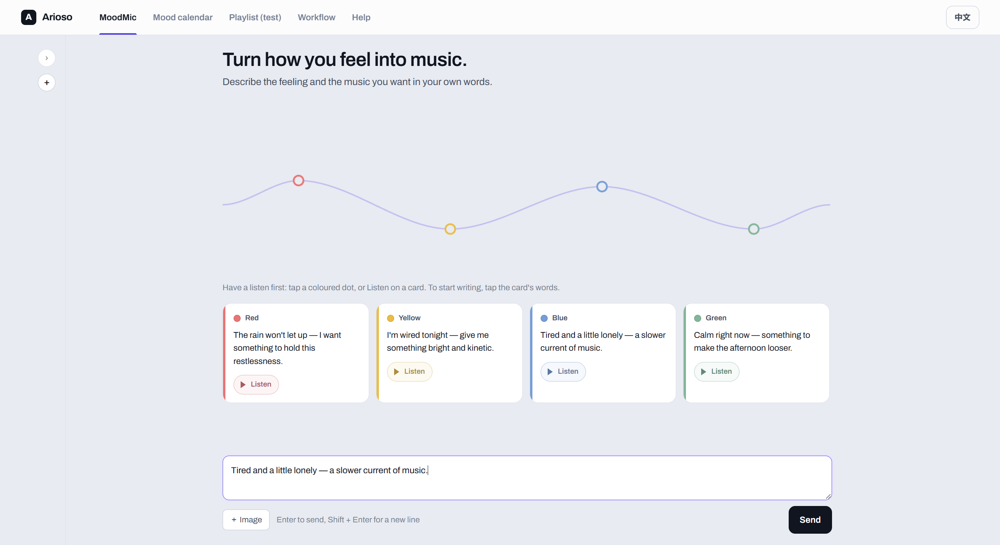
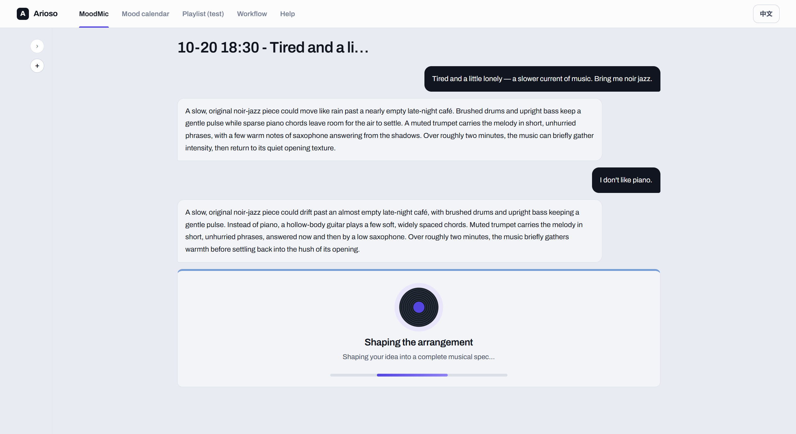
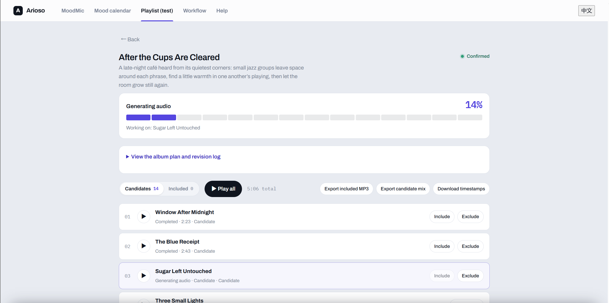
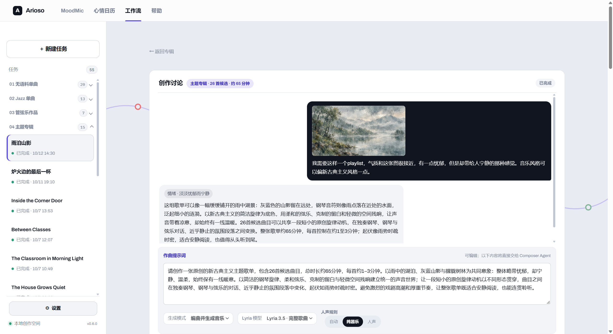

# Arioso

Arioso turns a musical idea into finished music. Describe what you want in
plain words, refine it in conversation, and Arioso plans the piece and
generates the audio — from a single track to a full album.

It ships as a bilingual browser studio (简体中文 / English) and a command-line
interface, with two ways in: **MoodMic**, which starts from how you feel and
ends with a playlist, and the **Workflows** studio, which starts from a brief
and offers four ways to work.

## MoodMic: From Emotions to Playlist

MoodMic is the everyday path. Say how you feel in everyday words and the
direction settles in conversation; the agreed mood is then read out as a colour
and a word, which you can change before creating. On an empty conversation you
can start from four example feelings, one per mood colour.



A piece you keep can continue into an album without leaving the conversation,
so feeling, discussion, plan, audio, and review stay one thread.



Every finished candidate lands in the playlist, where you audition it and mark
tracks for inclusion. The included set plays continuously in a persistent
player and exports as a single MP3 with timestamps.



Each check-in also records its colour on a month calendar, so you can look back
at a feeling and reopen the conversation behind it.

## Workflows: Four Working Modes

The Workflows tab opens on four ways to create music, each one a card marked
with its own colour:

- **General composition** — one piece from the model's own musical knowledge;
- **Jazz** — a piece grounded in a local corpus of the standards;
- **Orchestral** — a coherent multi-movement work;
- **Album** — a multi-track set with candidate review, ordering, and export.


Entering a card opens that workflow's composer. An album can also be planned
through a creative discussion — messages, optional image references, and a
proposal to approve — before any audio is generated.



All four modes share one pipeline — brief, an optional creative discussion, a
router that picks the mode, the composition agents, Lyria, and a saved result:


## Under the hood


Three stages, with the dashed boxes showing who does the work — the
application, the agent, and the cloud services:

1. **A feeling in.** A check-in — colour, word, one sentence — opens a
   conversation, and the direction settles inside it.
2. **Plan, confirm, render.** The agent writes a `MusicSpec`: a structured
   specification fixing instrumentation, structure, tempo, and one
   production-ready Lyria prompt. Nothing is rendered before you approve the
   plan, and an approval is bound to the revision you saw. Lyria renders one
   take.
3. **Review and keep.** Gemini listens to the take and returns a
   match-or-mismatch verdict against the approved request. A match is kept and
   joins the playlist, where it can be ordered and exported as one MP3; a
   mismatch asks you to regenerate. A kept song can also seed an album, which
   re-enters the same plan-and-approve loop before any candidate is generated.

## Requirements

- Windows or macOS;
- Node.js 22 or newer and pnpm 11.19.0, as declared in `package.json`;
- an OpenAI API key for composition; and
- a Gemini API key with Lyria access for audio generation.

Every core web and CLI workflow runs on Windows and macOS. Only the optional
historical-denoising production stage is Windows-only; on macOS you can still
compose, generate album candidates, manage playlists, and export tracks.

## Quick start

```shell
git clone https://github.com/666feiyu666/Arioso.git
cd Arioso
corepack enable
pnpm install --frozen-lockfile
pnpm web
```

Open <http://127.0.0.1:4173> and configure the required API keys in Settings.

If Corepack is unavailable, install pnpm 11.19.0 first.

## Example output

- [Afternoon Study](https://www.bilibili.com/video/BV1p5pc6AEX2/?share_source=copy_web&vd_source=db5fe656aa211faf8e79db42720c8bda) — v0.3.0, full playlist
- [雨泊山影 | When Blue Meets Calm | 学习、阅读、桌游背景音](https://www.bilibili.com/video/BV1jcpR66Ea/?share_source=copy_web&vd_source=db5fe656aa211faf8e79db42720c8bda) — v0.6.0, mood and music direction
- [大提琴的寂寞｜城市夜色中的低频旋律](https://www.bilibili.com/video/BV1DwJt65EKc/?share_source=copy_web&vd_source=db5fe656aa211faf8e79db42720c8bda) — v0.9.0, MoodMic playlist

## Command line

For CLI use, copy `.env.example` to `.env` and replace the placeholders, then
run one of the supported commands:

```shell
pnpm dev compose "A quiet nocturne for piano and muted trumpet."
pnpm dev generate "A quiet nocturne for piano and muted trumpet."
pnpm dev produce-album "A calm instrumental album for late-night reading."
pnpm dev stitch "album.mp3" "part-1.mp3" "part-2.mp3"
```

`produce-album` includes the Windows-only denoising stage; on macOS use the
browser's album workflow instead.

## Development

```shell
pnpm typecheck
pnpm test
pnpm build
```

See [`docs/development.md`](docs/development.md) for development commands and
[`pipeline/USAGE.md`](pipeline/USAGE.md) for the optional Windows production
pipeline.
