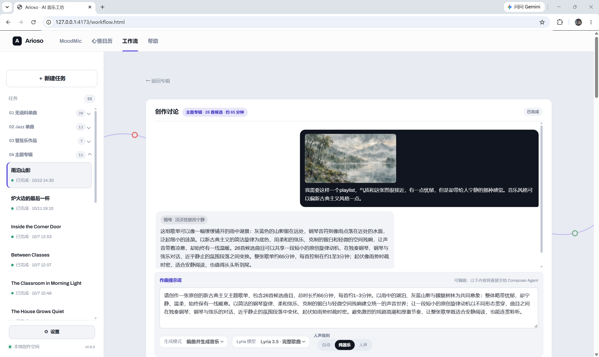
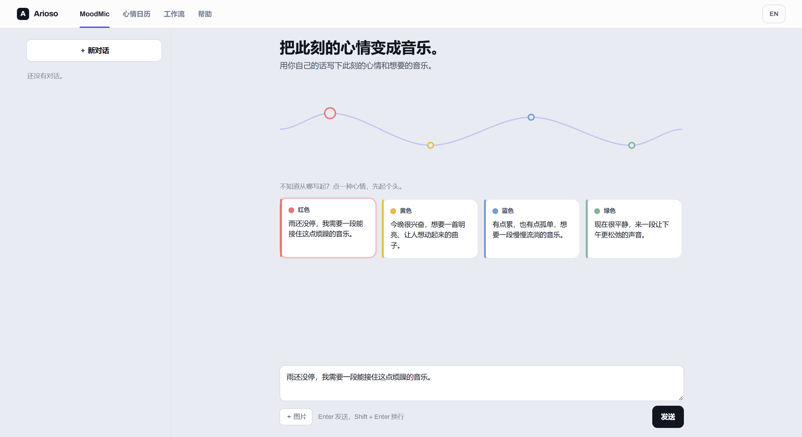
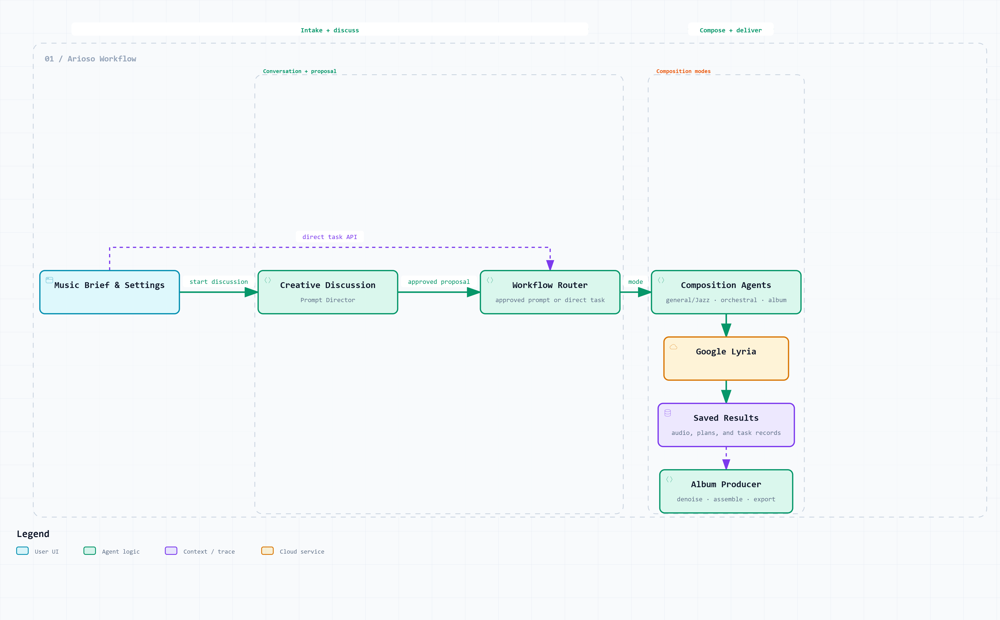

# Arioso

Arioso turns a musical idea into finished music. Describe what you want in
plain words, refine it in conversation, and Arioso plans the piece and
generates the audio — from a single track to a full album.

Arioso ships as a bilingual browser studio and a command-line interface, and
supports four ways to create music:

- general composition from a free-form brief;
- Jazz composition in the style of the standards;
- coherent multi-movement orchestral works; and
- multi-track albums with candidate review, playlist ordering, playback, and
  MP3 export.

MoodMic is a mood-aware starting point for these workflows: develop an idea
through creative discussion, optional image references, and mood cues, then
approve the resulting proposal before composition. Every check-in is recorded
on a mood calendar, so you can look back at a feeling and reopen the music it
produced.

## Interface

Arioso runs as a bilingual web studio (简体中文 / English) alongside the
command line. The browser interface has four tabs: **MoodMic**, **Mood
calendar**, **Workflows**, and **Help**.

### Workflows

The Workflows tab opens on four ways to create music — one piece from the
model's own knowledge, a Jazz piece grounded in the standards, a multi-movement
orchestral work, and a multi-track album. Each is a card marked with its own
colour; entering one opens that workflow's composer.


The album workflow walks an idea through creative discussion before composition,
then lines up the generated candidates as a playlist you can audition and
export.



### MoodMic

MoodMic turns how you feel right now into a single piece. Describe the feeling
in everyday words; once a direction is agreed, a mood is read out — a colour
and a word — which you can change before creating. On an empty conversation you
can start from four example feelings, one per mood colour; picking one fills
the composer, and the same four colours carry through the interface and the
mood calendar.



### Mood calendar

Every check-in from MoodMic is marked on a month grid with the colour of that
day's feeling, in the order the entries were made. Pick a day to read it back
and reopen the conversation behind it.

## Workflow



## Example output

Listen to these Arioso outputs:

- [Afternoon Study](https://www.bilibili.com/video/BV1p5pc6AEX2/?share_source=copy_web&vd_source=db5fe656aa211faf8e79db42720c8bda) v0.3.0: Full Playlist Supported
- [雨泊山影 | When Blue Meets Calm | 学习、阅读、桌游背景音](https://www.bilibili.com/video/BV1jcpR66Ea/?share_source=copy_web&vd_source=db5fe656aa211faf8e79db42720c8bda) v0.6.0: Mood + Music Direction kickoff


## Requirements

- Windows or macOS;
- Node.js 22 or newer;
- pnpm 11.19.0, as declared in `package.json`;
- an OpenAI API key for composition; and
- a Gemini API key with Lyria access for audio generation.

The core web and CLI workflows support Windows and macOS. The optional
historical-denoising production workflow currently supports Windows only.
macOS users can still compose and generate album candidates, manage playlists,
and export their selected tracks without denoising.

## Quick start

```shell
git clone https://github.com/666feiyu666/Arioso.git
cd Arioso
corepack enable
pnpm install --frozen-lockfile
pnpm web
```

Open <http://127.0.0.1:4173> and configure the required API keys in Settings.

If Corepack is unavailable, install pnpm 11.19.0 separately before running
`pnpm install`.

## Command line

For CLI use, copy `.env.example` to `.env` and replace the placeholders:

```powershell
# Windows PowerShell
Copy-Item .env.example .env
```

```shell
# macOS
cp .env.example .env
```

Then run one of the supported commands:

```shell
pnpm dev compose "A quiet nocturne for piano and muted trumpet."
pnpm dev generate "A quiet nocturne for piano and muted trumpet."
pnpm dev produce-album "A calm instrumental album for late-night reading."
pnpm dev stitch "album.mp3" "part-1.mp3" "part-2.mp3"
```

`produce-album` includes the Windows-only denoising production stage. Use the
browser's standard album workflow on macOS.

## Verification

```shell
pnpm typecheck
pnpm test
pnpm build
```

See [`docs/development.md`](docs/development.md) for development commands and
[`pipeline/USAGE.md`](pipeline/USAGE.md) for the optional Windows production
pipeline.
