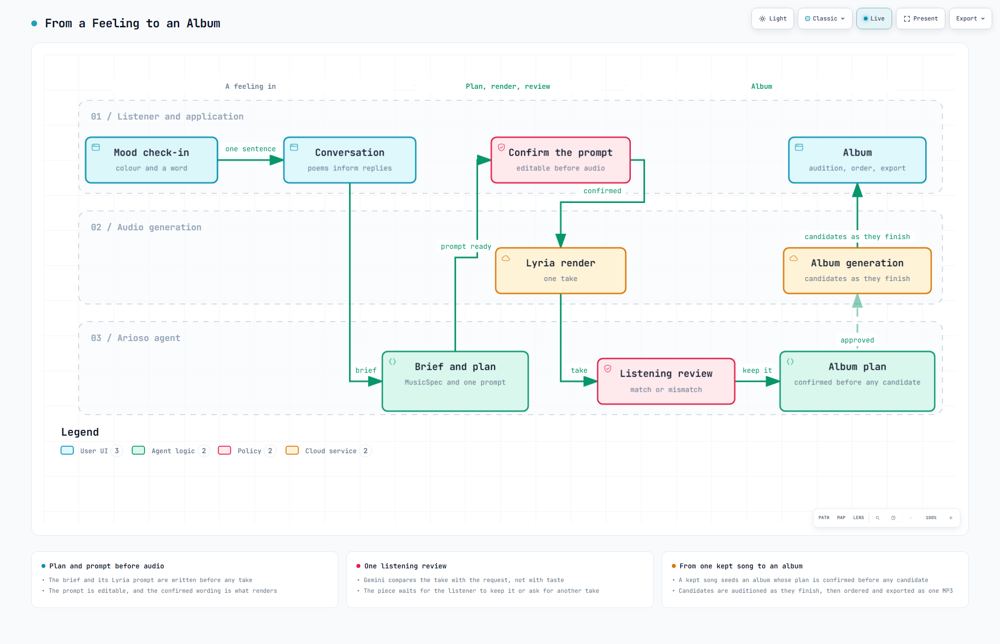
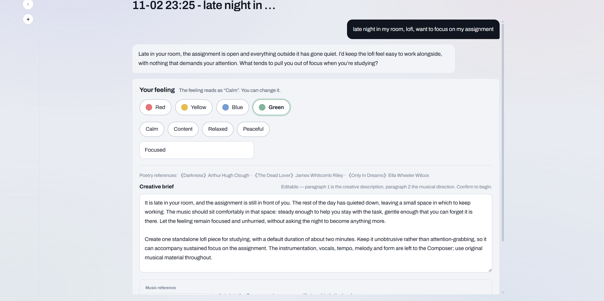
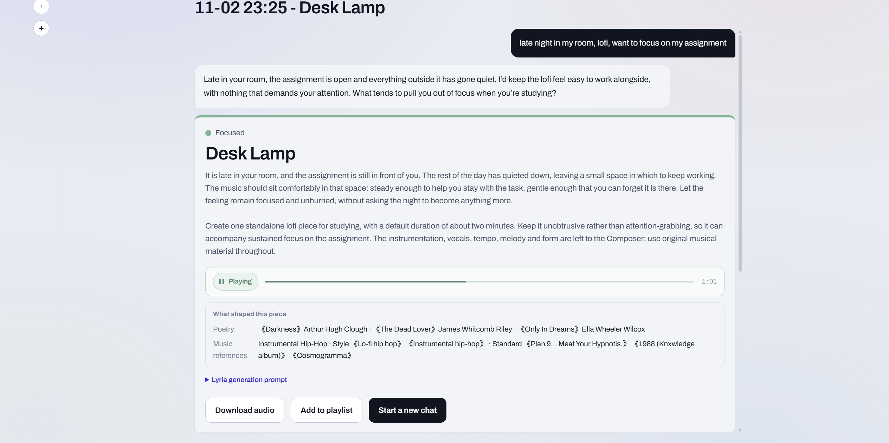
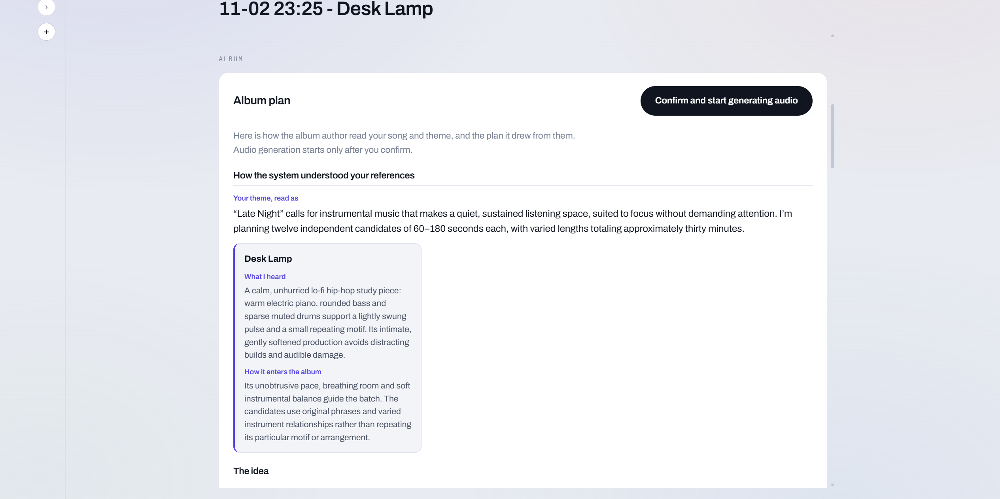
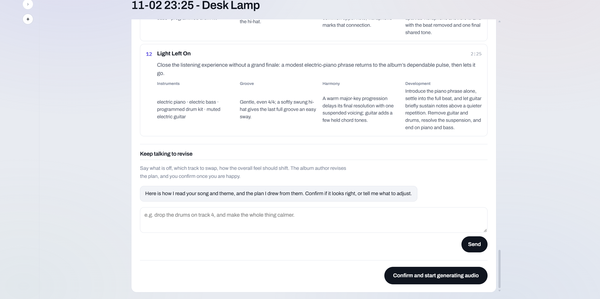
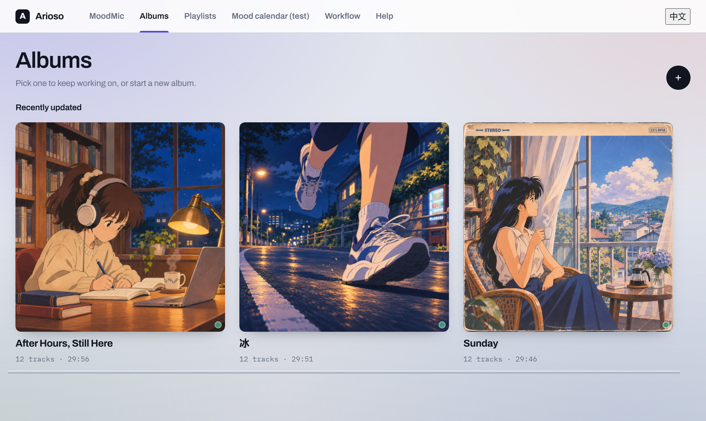
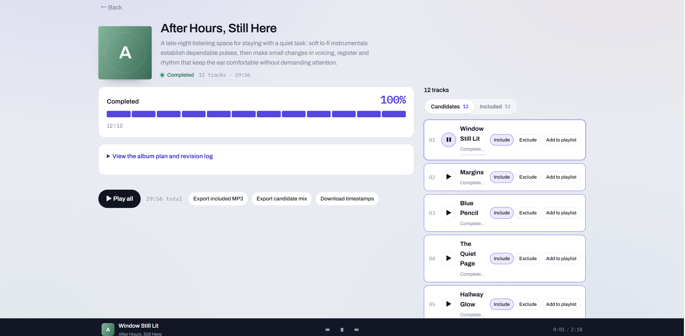
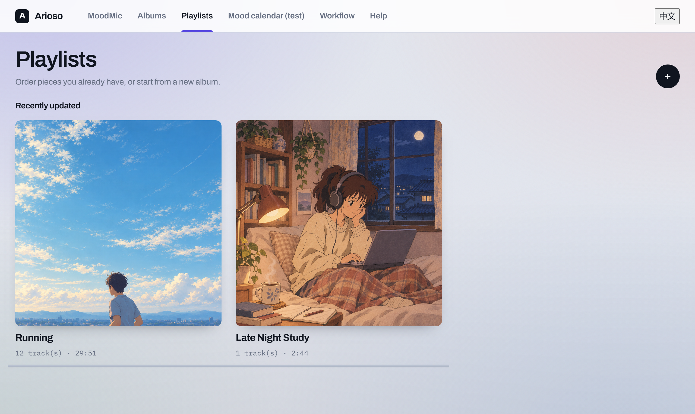
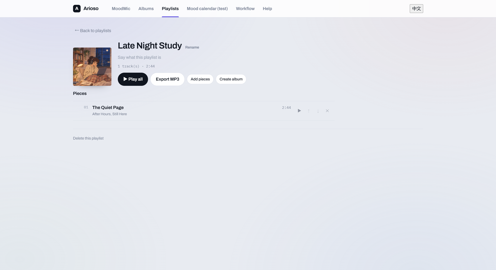

# Arioso

Arioso turns a feeling into music. You describe how you feel, the direction is
settled in conversation, and the music is planned, made and checked before you
keep it. A kept song can grow into an album.

It runs in a browser, in Chinese or English, and in a terminal.



## From a Feeling to an Album

1. **A feeling in.** You record a colour, a word and a sentence. That opens a
   conversation, and the reply comes with poems from a local collection in both
   languages. The mood stays yours to change while you talk: the colour group
   and its words sit under the reply, the poems are named, and the brief is
   rewritten as the conversation moves.

   

2. **Plan, confirm, listen.** The agent writes an editable brief and a musical
   plan to go with it. Both are yours to change, and nothing is made until you
   confirm the plan. One take comes back.

3. **Keep it or ask again.** A listening check compares the take with what you
   asked for. The piece then waits: keep it, or ask for another take. A kept
   piece comes with a player, the poems and references that shaped it, the
   prompt that produced it, and buttons to download it, add it to a playlist or
   start a new conversation.

   

4. **From the kept song to an album.** A kept song becomes the starting point
   for an album. The album author says how it read your references and the
   theme, then sets out the idea, the shared sound, and how the tracks stay
   related while changing. Nothing is generated until you confirm, and you can
   keep revising the plan while you decide.

   

   Each track outline carries its instruments, groove, harmony and development,
   so a request such as dropping the drums on one track can be answered in the
   conversation before you confirm.

   

## Album & Playlist

### Album

The Albums page lists your albums, most recently updated first. Each card shows the cover, the number of tracks and the running time. The round button in the corner starts a new one.



A new album starts from references. The drawer lists your MoodMic conversations and the songs you kept from them, each with a Listen button. What you pick goes to the album author with the direction behind that song. Under the list you write the theme in your own words and set the track count and target duration. Refresh asks for a new reading of the theme, and the button at the end hands the whole thing over.

The album page reports the plan while it runs. A bar counts the finished tracks, and each one shows the part it plays, its length, and a choice to keep it or leave it out. Play all plays the kept tracks in order. From the same row you can save them as one file, keep the alternates as a second mix, or download a list of timestamps. The plan and every change to it sit one click away.



### Playlist

A playlist orders pieces that already exist and never plans or generates. A finished album can be added to one, a track at a time or whole. Reordering, renaming or removing an entry leaves the audio untouched. The Playlists page uses the same cards as the Albums page.



Opening a playlist shows its pieces with the album each came from, its length, and controls to play or remove it. Play all runs the set in order, Export MP3 joins it into one file, Add pieces appends more of what you already have, and Create album opens the same drawer as the Albums page.



## Requirements

- Windows or macOS;
- Node.js 22 or newer and pnpm 11.19.0, as declared in `package.json`;
- an OpenAI API key, which writes the plan; and
- a Google Gemini API key with access to music generation (Lyria).

## Quick start

```shell
git clone https://github.com/666feiyu666/Arioso.git
cd Arioso
corepack enable
pnpm install --frozen-lockfile
pnpm web
```

Open <http://127.0.0.1:4173> and configure the required API keys in Settings.

If Corepack is unavailable, install pnpm 11.19.0 first.

## Example output

- [Afternoon Study](https://www.bilibili.com/video/BV1p5pc6AEX2/?share_source=copy_web&vd_source=db5fe656aa211faf8e79db42720c8bda) · v0.3.0, full playlist
- [雨泊山影 | When Blue Meets Calm | 学习、阅读、桌游背景音](https://www.bilibili.com/video/BV1jcpR66Ea/?share_source=copy_web&vd_source=db5fe656aa211faf8e79db42720c8bda) · v0.6.0, mood and music direction
- [大提琴的寂寞｜城市夜色中的低频旋律 | Jazz Playlist](https://www.bilibili.com/video/BV1DwJt65EKc/?share_source=copy_web&vd_source=db5fe656aa211faf8e79db42720c8bda) · v0.9.0, MoodMic album, noir jazz
- [熙熙攘攘，我们的黄昏 | 心情低落时不妨听听 | 器乐摇滚Playlist](https://www.bilibili.com/video/BV1ucHK6pELM/?share_source=copy_web&vd_source=db5fe656aa211faf8e79db42720c8bda) · v0.9.0, MoodMic album, instrumental rock
- [Sunday | 无所事事的午后 | CityPop Playlist](https://www.bilibili.com/video/BV12Bx46HEQq/?share_source=copy_web&vd_source=db5fe656aa211faf8e79db42720c8bda) · v0.9.0, MoodMic album, city pop
- [After Hours, Still Here | 深夜学习 | Lofi-Hiphop](https://www.bilibili.com/video/BV1U64A6dEAR/?share_source=copy_web&vd_source=db5fe656aa211faf8e79db42720c8bda) · v0.9.0, MoodMic album, lofi-hiphop and the album shown in [From a Feeling to an Album](#From-a-Feeling-to-an-Album)

## Development

```shell
pnpm typecheck
pnpm test
pnpm build
```

See [`docs/development.md`](docs/development.md) for development commands.
[`docs/current.md`](docs/current.md) describes the rest of the system.
