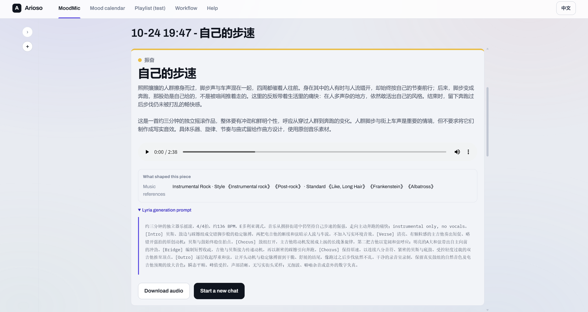
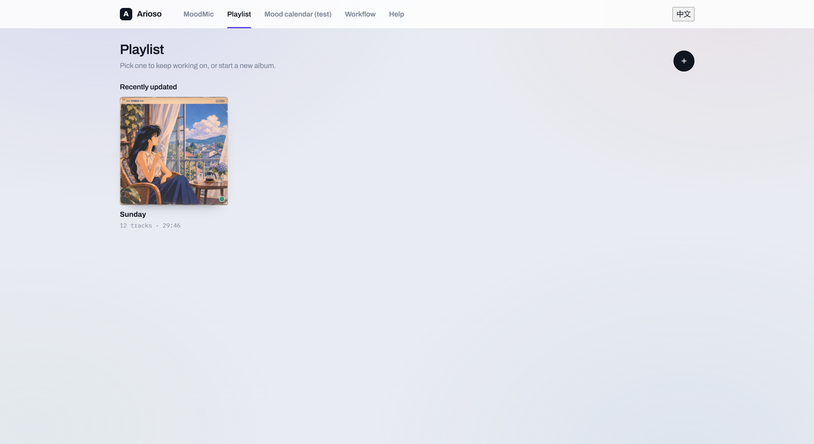
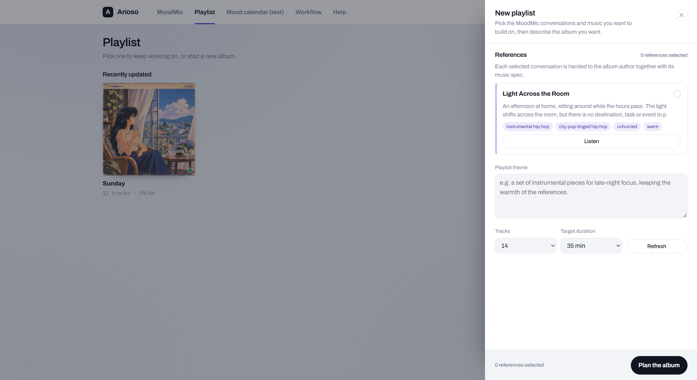
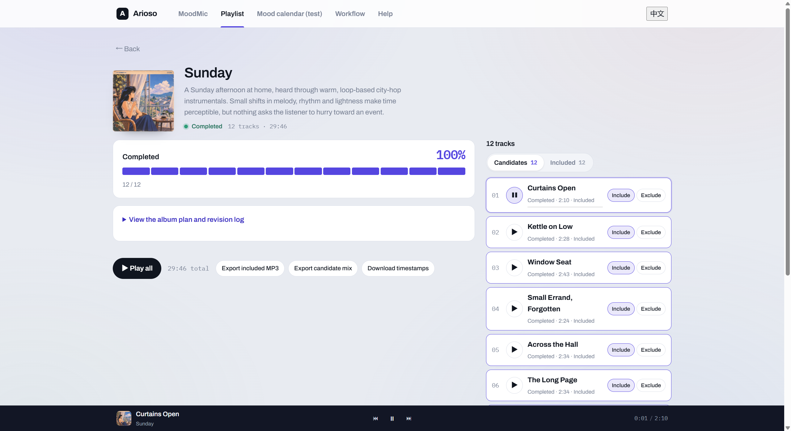

# Arioso

Arioso turns a feeling into music. You describe how you feel, the direction is
settled in conversation, and the music is planned, made and checked before you
keep it. A kept song can grow into an album.

It runs in a browser, in Chinese or English, and in a terminal.


## From a feeling to a playlist

1. **A feeling in.** You record a colour, a word, and a sentence. That opens a
   conversation, and the reply comes with poems drawn from a local collection in
   both languages. You can change the mood word or ask for a different length,
   and the brief is rewritten as you talk.

   

2. **Plan, confirm, listen.** The agent writes an editable brief and a musical
   plan to go with it. Both are yours to change, and nothing is made until you
   confirm the plan. One take comes back.

3. **Keep it or ask again.** A listening check compares the take with what you
   asked for. The piece then waits: keep it, or ask for another take. A kept
   piece arrives with a player, the earlier pieces that shaped it, and the words
   that produced it.

   

4. **From the kept song to a playlist.** A kept song becomes the starting point
   for an album. The album plan sets out the idea, the shared sound, and how the
   tracks stay related while changing. You confirm the plan before anything is
   made, tracks appear as they finish, and the ones you include are put in order
   and saved as one audio file with timestamps.

   

## Building a playlist

The Playlist page lists the albums you have made, most recently updated first. Each card shows the cover, the number of tracks and the running time, and the round button in the corner starts a new one.



A new album starts from references. The drawer lists your MoodMic conversations and the songs you kept from them, each with a Listen button, and passes what you choose to the album author together with the direction behind that song. Under the list you write the theme in your own words, then set how many tracks you want and how long the album should run. Refresh asks for a new reading of the theme before you commit, and the button at the end of the drawer hands the whole thing over.



The album page reports the plan while it runs. A bar counts the finished tracks, and each one waits with the part it plays, its length, and a choice to keep it or leave it out. Play all plays the kept tracks in order. From the same row you can save them as a single file, keep the alternates as a second mix, or download a list of timestamps. The plan and every change made to it sit one click away.



## Requirements

- Windows or macOS;
- Node.js 22 or newer and pnpm 11.19.0, as declared in `package.json`;
- an OpenAI API key, which writes the plan; and
- a Google Gemini API key with access to music generation (Lyria).

## Quick start

```shell
git clone https://github.com/666feiyu666/Arioso.git
cd Arioso
corepack enable
pnpm install --frozen-lockfile
pnpm web
```

Open <http://127.0.0.1:4173> and configure the required API keys in Settings.

If Corepack is unavailable, install pnpm 11.19.0 first.

## Example output

- [Afternoon Study](https://www.bilibili.com/video/BV1p5pc6AEX2/?share_source=copy_web&vd_source=db5fe656aa211faf8e79db42720c8bda) · v0.3.0, full playlist
- [雨泊山影 | When Blue Meets Calm | 学习、阅读、桌游背景音](https://www.bilibili.com/video/BV1jcpR66Ea/?share_source=copy_web&vd_source=db5fe656aa211faf8e79db42720c8bda) · v0.6.0, mood and music direction
- [大提琴的寂寞｜城市夜色中的低频旋律](https://www.bilibili.com/video/BV1DwJt65EKc/?share_source=copy_web&vd_source=db5fe656aa211faf8e79db42720c8bda) · v0.9.0, MoodMic playlist
- [熙熙攘攘，我们的黄昏 | 心情低落时不妨听听 | 器乐摇滚Playlist](https://www.bilibili.com/video/BV1ucHK6pELM/?share_source=copy_web&vd_source=db5fe656aa211faf8e79db42720c8bda) · v0.9.0, MoodMic playlist, also example playlist shown above
- [Sunday | 无所事事的午后 | CityPop Playlist](https://www.bilibili.com/video/BV12Bx46HEQq/?share_source=copy_web&vd_source=db5fe656aa211faf8e79db42720c8bda) · v0.9.0, MoodMic playlist, and the album shown in [Building a playlist](#building-a-playlist)

## Development

```shell
pnpm typecheck
pnpm test
pnpm build
```

See [`docs/development.md`](docs/development.md) for development commands and
[`docs/current.md`](docs/current.md) for the rest of the system.
