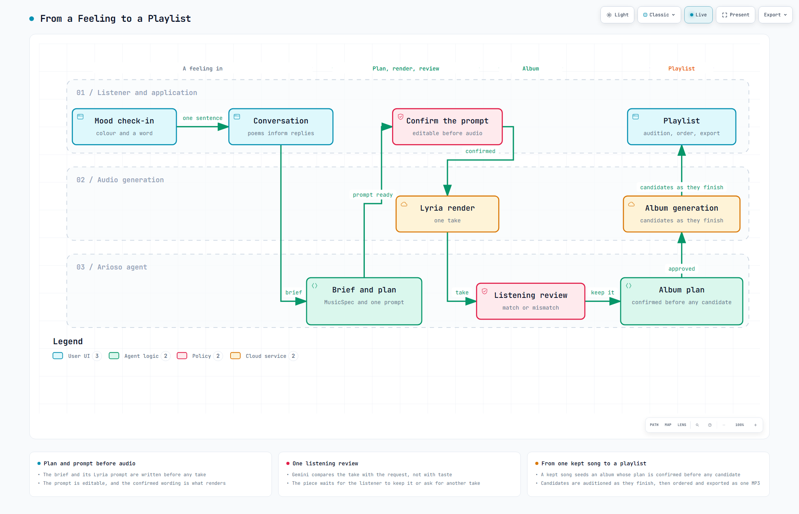
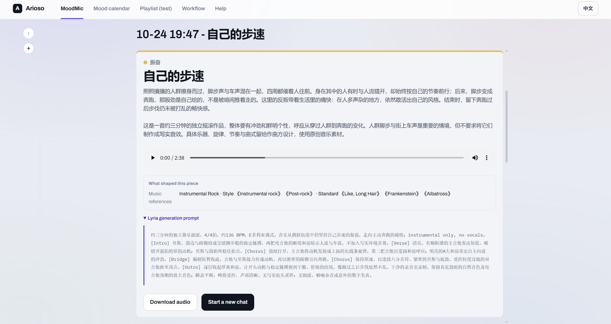

# Arioso

Arioso turns a feeling into finished music and a finished playlist. Say how you
feel in plain words, settle the direction in conversation, and Arioso plans the
piece, generates the audio, and carries what you keep into an album and a
playlist.

It ships as a bilingual browser studio (简体中文 / English) and a command-line
interface.



## From a Feeling to a Playlist

1. **A feeling in.** A check-in — colour, word, one sentence — opens a
   conversation. Poems retrieved from a local bilingual corpus inform each reply,
   and the direction settles in the conversation: you can correct the mood, the
   length, or the ending, and the brief is rewritten in front of you.

   

2. **Plan, confirm, render.** The agent writes an editable brief, then a complete
   `MusicSpec` with one production-ready Lyria prompt. You can edit that prompt,
   and no audio is generated until you confirm it. Lyria renders one take, and
   nothing else is regenerated on its own.

3. **Listen, keep, or ask again.** Gemini compares the take with the request.
   The piece waits for you: keep it, or ask for another take. A kept piece arrives
   with its player, the references that shaped it, and the prompt that produced
   it.

   

4. **From the kept song to a playlist.** A kept song seeds an album. The album
   plan states the idea, the shared sound, and how the candidates stay coherent
   while changing; it is confirmed before any candidate is generated. Candidates
   arrive while you listen, and the included set is ordered and exported as one
   MP3 with timestamps.

   

## Requirements

- Windows or macOS;
- Node.js 22 or newer and pnpm 11.19.0, as declared in `package.json`;
- an OpenAI API key for composition; and
- a Gemini API key with Lyria access for audio generation.

## Quick start

```shell
git clone https://github.com/666feiyu666/Arioso.git
cd Arioso
corepack enable
pnpm install --frozen-lockfile
pnpm web
```

Open <http://127.0.0.1:4173> and configure the required API keys in Settings.

If Corepack is unavailable, install pnpm 11.19.0 first.

## Example output

- [Afternoon Study](https://www.bilibili.com/video/BV1p5pc6AEX2/?share_source=copy_web&vd_source=db5fe656aa211faf8e79db42720c8bda) — v0.3.0, full playlist
- [雨泊山影 | When Blue Meets Calm | 学习、阅读、桌游背景音](https://www.bilibili.com/video/BV1jcpR66Ea/?share_source=copy_web&vd_source=db5fe656aa211faf8e79db42720c8bda) — v0.6.0, mood and music direction
- [大提琴的寂寞｜城市夜色中的低频旋律](https://www.bilibili.com/video/BV1DwJt65EKc/?share_source=copy_web&vd_source=db5fe656aa211faf8e79db42720c8bda) — v0.9.0, MoodMic playlist
- [器乐摇滚 Playlist | 心情低落时不妨听听] (https://www.bilibili.com/video/BV1ucHK6pELM/?share_source=copy_web&vd_source=db5fe656aa211faf8e79db42720c8bda) - v0.9.0, which is also the example playlist shown above.

## Development

```shell
pnpm typecheck
pnpm test
pnpm build
```

See [`docs/development.md`](docs/development.md) for development commands and
[`docs/current.md`](docs/current.md) for the implementation beyond this path.
